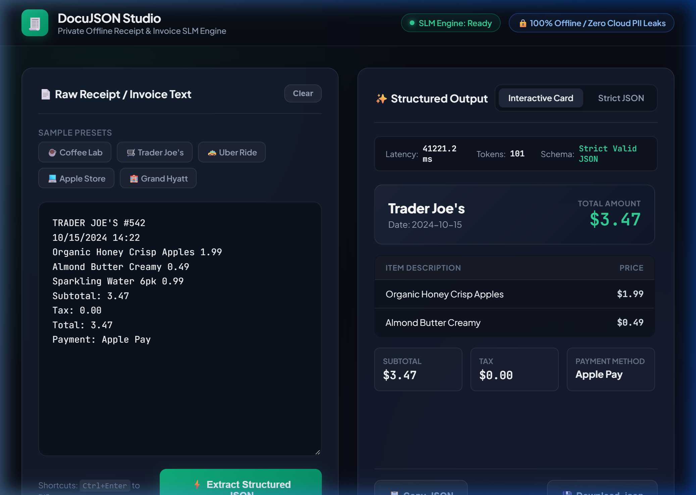

# DocuJSON Studio - Private Receipt & Invoice Extractor (Local SLM)

An enterprise-ready, 100% offline document intelligence tool powered by a fine-tuned 0.5B Small Language Model (SLM). Transforms messy receipt text, billing statements, and unstructured OCR output into strict, validated JSON.

<p align="center">
  
</p>

---

## 🔒 Enterprise Privacy & Compliance
- **Zero Cloud Leakage**: Runs entirely on local CPU / Edge devices. No financial data, card numbers, or customer PII ever leave your private network.
- **Strict JSON Generation**: Guaranteed schema with `vendor`, `date`, `items`, `subtotal`, `tax`, `total`, and `payment_method`.
- **Low Compute Overhead**: Runs on standard CPU with ~1 GB RAM footprint.

---

## 🚀 Quick Start

### 1. Model Weights Setup
Due to GitHub's 100MB file limit, model weight binaries (`*.gguf` / `*.safetensors`) are excluded from git.
- Place `docujson.f16.gguf` in the project root, or `model.safetensors` inside `model/`.
- All tokenizer files and web UI assets are pre-packaged in the repository.

### 2. Requirements
Ensure Python 3.9+ is installed. Install dependencies:
```bash
pip install -r requirements.txt
```

### 3. Launch the Application
Double-click `start.bat` on Windows, or execute:
```bash
python -m uvicorn server:app --host 127.0.0.1 --port 8001
```

Open your browser to:
👉 **[http://localhost:8001](http://localhost:8001)**

---

## 📡 API Integration

Integrate DocuJSON directly into your existing ERP, accounting, or billing pipeline:

### Endpoint: `POST /api/extract`
**Request Body**:
```json
{
  "text": "COFFEE LAB & ROASTERS\nDate: 2024-11-04\n1x Oat Flat White $5.50\n1x Almond Croissant $4.75\nSubtotal: $10.25\nTax: $0.82\nTotal: $11.07\nPaid with VISA ending 9821"
}
```

**Response**:
```json
{
  "success": true,
  "data": {
    "vendor": "Coffee Lab & Roasters",
    "date": "2024-11-04",
    "items": [
      {
        "name": "Oat Flat White",
        "price": 5.50
      },
      {
        "name": "Almond Croissant",
        "price": 4.75
      }
    ],
    "subtotal": 10.25,
    "tax": 0.82,
    "total": 11.07,
    "payment_method": "VISA"
  },
  "latency_ms": 1420.5,
  "tokens_generated": 118
}
```

---

## 📦 Local Edge Deployment (GGUF)
A pre-quantized `docujson.f16.gguf` file is included for edge runtimes (such as Ollama or `llama.cpp`):

```bash
ollama create docujson -f Modelfile
ollama run docujson
```
